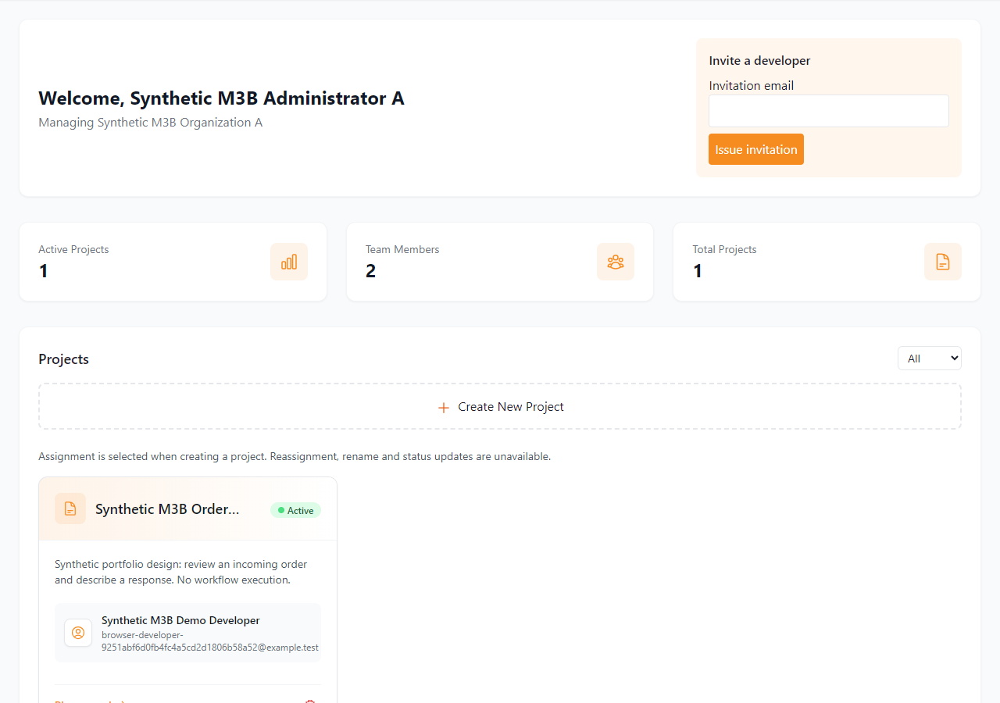
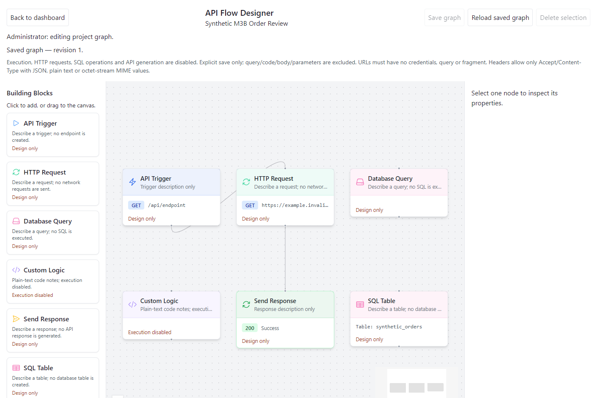
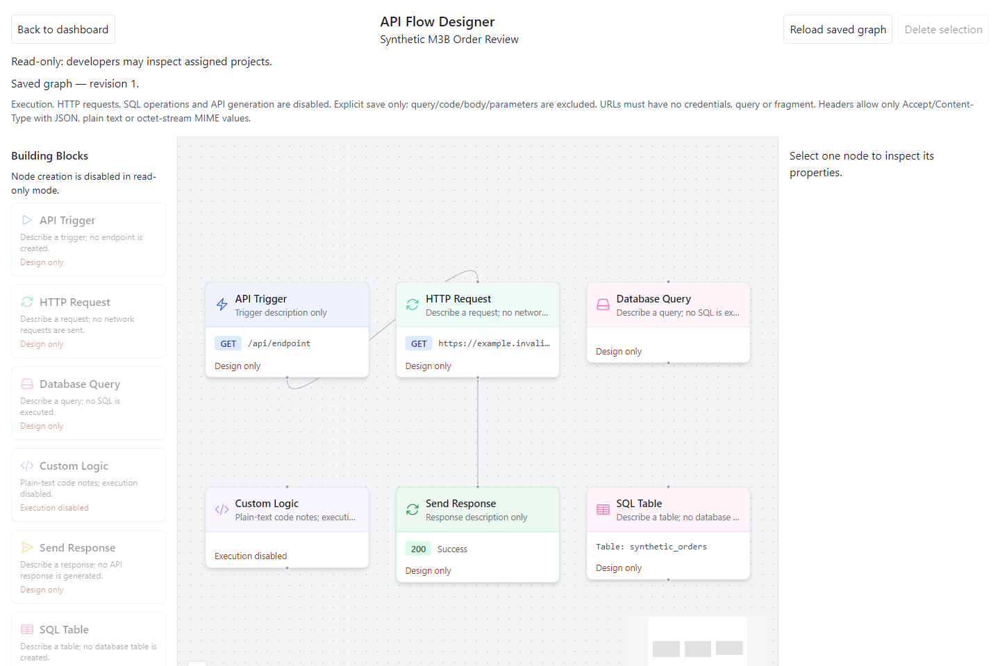

# Boiler-Room / TDS

**M7C.2 local preparation:** the accepted minimatch advisory remains unpatched and visible (five moderate package entries, one advisory). The dependency runner now evaluates only that exact reviewed graph and source/install/workflow/production/upstream conditions; new or unverifiable inputs fail closed. Production auditing remains zero-only and registry signatures remain required. See [dependency evidence](DEPENDENCY_SECURITY.md) and [testing](TESTING.md). GitHub-hosted CI has not run. This private source-available candidate has no first-party open-source grant or upload approval. Original four-person credits and separate October 2026 modernization remain unchanged.

A local software-engineering portfolio application for organization-scoped projects and visual graph design. An ASP.NET Core API and React frontend provide invitation-based access, administrator/developer permissions, and PostgreSQL-backed graph save/reload with optimistic concurrency.

**Graphs describe designs; they do not execute workflows, SQL, HTTP requests, custom code or generated APIs.** This is a locally verified academic portfolio application, with no production deployment or certification claim.

[Architecture](docs/ARCHITECTURE.md) · [Demo walkthrough](DEMO.md) · [Testing](TESTING.md) · [Security](SECURITY.md)

## Background and contributors

Originally developed by **Landon Dahmen, Zander Wysong, Telson Cowan and Jake McBride** as a four-person **South Dakota State University senior-design project, Fall 2024–Spring 2025**, associated with Triode Data Systems. The owner identifies this recovered copy as the April 2025 Senior Design Expo version, followed by a sanitation pass. Sponsor association does not imply endorsement of this portfolio copy.

**Landon's individual October 2026 modernization** added the current local security model, explicit reconstructed database setup, graph persistence/concurrency, automated verification, tooling upgrades and documentation. These improvements are separate from the original team's implementation. Landon reports original contributions to backend development, Python-assisted SQLite-to-PostgreSQL migration, APIs/testing, architecture and integration. The historical migration scripts are absent; this statement does not assign exclusive ownership of individual files. No Git history is available in this recovered workspace to verify per-file authorship.

## What the current application demonstrates

- HTTPS cookie authentication, CSRF protection, invitation-only developer registration, profiles and password changes.
- Organization-scoped administrators and developers restricted to assigned projects; backend authorization accompanies frontend route guards.
- Project creation with a developer assignment, scoped lists and administrator deletion. Reassignment, project rename and status updates are unavailable.
- Six React Flow design categories: API Trigger, HTTP Request, Database Query, Custom Logic, Send Response and SQL Table; node/edge editing for administrators and read-only inspection for assigned developers.
- Explicit save of validated declarative graphs to PostgreSQL JSONB, reload after navigation/refresh, and revision conflicts that retain the unsaved draft rather than overwrite newer data.
- Disposable-database integration/security/graph/browser verification and locally validated GitHub Actions definitions.

The original Backend-as-a-Service concept is historical context, not a claim of a working execution platform. Generic SQL/dynamic API features are disabled. Password recovery and distributed/durable authentication sessions are not implemented. The current website uses factual project information, unavailable-page messaging and original neutral assets; [third-party notices](THIRD_PARTY_NOTICES.md) record asset provenance and remaining licensing limits.

## Technology and architecture

| Layer | Current implementation |
| --- | --- |
| Browser | React 19, React Router 7, React Flow 11, Tailwind CSS 3 |
| Frontend tooling | Vite 8, Vitest 5, ESLint 10; editor route loaded on demand |
| API | C# / ASP.NET Core on .NET 10; cookie/CSRF authentication; BCrypt password hashing |
| Data | Npgsql 9, PostgreSQL 16.15; explicit SQL initialization/migrations |
| Local infrastructure | Docker Compose for PostgreSQL; trusted localhost HTTPS for API and frontend |
| Verification | xUnit, isolated SQL/controller tests, HTTP probes and installed Microsoft Edge via Playwright |

The browser sends credentialed HTTPS requests to the API. Server-side account, role, organization and assignment checks constrain parameterized Npgsql operations. PostgreSQL stores users, projects, invitations and declarative project graphs. Docker hosts PostgreSQL; the API and Vite run as local processes. The browser has no direct database connection.

See the editable [Mermaid architecture diagram and source map](docs/ARCHITECTURE.md). Exact dependency pins remain in the existing project/lockfiles; the table does not imply permission to upgrade them.

## Application screenshots

Actual Microsoft Edge captures from a disposable synthetic environment on October 30, 2026. No production/customer data is shown. Crops omit unconfirmed branding and credential-bearing areas; the application DOM was not altered for presentation. The two editor views use the same dimensions; form/dashboard crops retain their native proportions. [Capture provenance and limits](docs/screenshots/README.md).

**Administrator projects and invitation controls**



**Saved graph after a full page reload** — six design categories, two edges, revision 1.



**Assigned developer access** — the same saved graph with creation/save controls restricted.



The [screenshot inventory](docs/screenshots/README.md) also includes the empty login form and project-creation dialog.

## Local development prerequisites

The verified environment is Windows, **PowerShell 7.2+**, **.NET SDK 10.0.403** (see `global.json`), **Node.js 22.14.0 / npm 10.9.2**, Docker Desktop using the Linux engine, and normally trusted localhost HTTPS certificates. Node must meet the manifest's engine range. Other OS/runtime combinations are not established by the Windows browser evidence.

Use a private local checkout and run the following from its root. No global tool installation or package upgrades are needed. Production/public hosting is outside these instructions.

### Restore and build

```powershell
pwsh -NoProfile -File scripts/Test-Frontend.ps1 -Task Restore
pwsh -NoProfile -File scripts/Test-Backend.ps1 -Task Restore
pwsh -NoProfile -File scripts/Test-Backend.ps1 -Task Build
pwsh -NoProfile -File scripts/Test-Frontend.ps1 -Task Build
```

Frontend restore uses the reviewed npm lockfile with lifecycle scripts disabled. Backend/test restore uses locked NuGet resolution. Keep the approved pins and do not substitute automatic audit-fix commands. Helper projects have separate restore/build requirements in [TESTING.md](TESTING.md) and the database guides.

### Database and private configuration

```powershell
pwsh -NoProfile -File scripts/Initialize-LocalEnvironment.ps1
pwsh -NoProfile -File scripts/Start-LocalDatabase.ps1
```

The initializer creates an ignored `.env` with independent random local passwords only when the file is absent; it does not overwrite valid existing settings. Do not print, commit or share that file. The development database defaults to `127.0.0.1:55432`, project `boilerroom-tds-portfolio`, container `boilerroom-tds-portfolio-postgres`, volume `boilerroom-tds-portfolio-pgdata`. Helpers refuse conflicting identities.

Numbered SQL initialization runs on a **new empty volume**. API startup requires schema markers 1/2/3. For an existing database, follow the explicit migration/backup procedures in [database/README.md](database/README.md) and [graph persistence](database/GRAPH_PERSISTENCE.md); never reset its volume to obtain a fresh demo. The supplied schema is a **2026 reconstruction**, not a recovered original database or migration history.

`Backend/appsettings.json` keeps its connection string blank. The API wrapper supplies process-only configuration; frontend `VITE_*` values are public and must contain no secrets. See [database authentication](database/AUTHENTICATION.md) for the restricted database role and operator provisioning.

### HTTPS and application startup

On a machine without the documented certificate, perform the normal local development-certificate setup once:

```powershell
New-Item -ItemType Directory -Path .local/https -Force
dotnet dev-certs https --export-path .local/https/localhost.pem --format Pem --no-password
dotnet dev-certs https --trust
```

Accept the normal OS trust workflow. Keep both generated PEM/key files private; never bypass browser or TLS validation. See [FRONTEND_INTEGRATION.md](FRONTEND_INTEGRATION.md) for verification and troubleshooting.

Start each application process in its own PowerShell terminal, after building:

```powershell
pwsh -NoProfile -File scripts/Start-LocalApi.ps1
```

```powershell
pwsh -NoProfile -File scripts/Start-LocalFrontend.ps1
```

Open **https://localhost:3000/login**; API origin is **https://localhost:8836**. Stop only your own application processes when finished. Leave persistent database resources intact.

## Demonstration and tests

[DEMO.md](DEMO.md) provides a repeatable isolated rehearsal and a human-readable tour of administrator provisioning, invitation registration, project permissions, graph persistence, revision conflicts and read-only access. Automated demo fixtures are removed by the guarded runner; they do not write to the persistent development database.

```powershell
pwsh -NoProfile -File scripts/Test-Backend.ps1 -Task Unit
pwsh -NoProfile -File scripts/Test-Frontend.ps1 -Task Unit
pwsh -NoProfile -File scripts/Test-Frontend.ps1 -Task Lint
pwsh -NoProfile -File scripts/Test-IsolatedDatabase.ps1 -Suite Database
node scripts/validate-ci.cjs
```

Build/restore prerequisites and separate Windows security/graph/Edge commands are in [TESTING.md](TESTING.md). Fixture suites must run sequentially against disposable resources on port 55433, with strict TLS and ownership checks.

**Latest focused M7B.3 evidence:** 100 frontend tests, ESLint 0/0, production build without a chunk warning and 108 real Edge content/signup/role/graph smoke checks pass. Disposable fixtures/resources were cleaned and development data preserved. These focused results do not replace or rerun the full prior suites.

Verified local evidence through M7A.1: **36 backend unit tests, 87 frontend tests, six isolated PostgreSQL tests plus transactional SQL checks**, security **120 assertions / 139 responses**, graph **116 / 100**, and Edge **104 / 297** (M6B). Backend/compiler and ESLint warnings are zero; production compilation has no chunk warning. Two React Flow development diagnostics remain documented. M7B adds a separate **19-check screenshot capture**, not another run of those full suites. See [CODE_QUALITY.md](CODE_QUALITY.md) and [screenshot provenance](docs/screenshots/README.md).

The three [GitHub Actions definitions](.github/workflows) have passed local static validation only; **no GitHub-hosted CI execution is claimed**. Earlier full/production npm and backend NuGet audits found no known advisories. The current full candidate audit reports the disclosed development-tool advisory; signatures pass, and the prior completed backend/test NuGet queries remain valid evidence; [DEPENDENCY_SECURITY.md](DEPENDENCY_SECURITY.md) preserves exact evidence and limitations.

## Security model and scope

The server validates authenticated database identity and tenant membership, including developer project assignment. Sessions use HttpOnly/Secure/Strict cookies, CSRF-protected writes, an absolute 30-minute default and revocation on logout/password change. Tickets are in-memory and end on API restart. Passwords use BCrypt and bounded input; invitation registration is email-bound, expiring and single-use. Explicit graph validation, parameterized SQL and restricted database credentials complement authorization.

These are selected verified local controls, not a security certification. Workflow execution remains disabled. Do not expose local services publicly. Read [SECURITY.md](SECURITY.md), [EDITOR_SECURITY.md](EDITOR_SECURITY.md) and [authentication details](database/AUTHENTICATION.md) for the actual boundaries.

## Publication, licensing and acknowledgments

The owner confirms that the original senior-design source may be published on their personal public GitHub portfolio with appropriate attribution. This records their confirmation; supporting permission documentation has not been reviewed and it is **not described as written authorization**.

This is a **source-available portfolio presentation**. **No broad first-party open-source license has been selected or granted.** Publishing on GitHub permits viewing and forking under GitHub's terms; it does not automatically grant broad independent reuse rights. See [GitHub's licensing guidance](https://docs.github.com/en/repositories/managing-your-repositorys-settings-and-features/customizing-your-repository/licensing-a-repository).

[THIRD_PARTY_NOTICES.md](THIRD_PARTY_NOTICES.md) identifies verified component notices, the original neutral mark's provenance and the unresolved xunit.abstractions exact-license issue. Those licenses apply to their identified third-party material, independently of first-party licensing. Preserve all four original team credits. Confidentiality, final selected-file security/notice review and publication authorization remain separate. This private clean source candidate is not approved for publication. No Git initialization, repository creation, upload, publication or deployment has been performed. The exact historical xunit.abstractions 2.0.3 license text remains unresolved; this source edition includes dependency references and locks, not its package binaries or copied source.

Thanks to the original SDSU team and academic project context, and to the maintainers of the frameworks and tools named above. This acknowledgment makes no sponsor endorsement or exclusive authorship claim.

## Clean source edition

This source-available portfolio edition retains buildable backend/frontend source, all meaningful tests and guarded tools, versioned schema reconstruction, exact manifests/locks, local setup guidance, architecture and five reviewed synthetic screenshots. Historical Bruno collections, obsolete HTTP/blocked PowerShell probes, disconnected frontend prototype modules, old CRA templates and private audit/relocation records are preserved privately in the development workspace. Dormant backend types remain because SDK compilation and legacy-contract tests require them. No historical source authorship is reassigned.

This copy contains no dependencies, compiled output, database data, private TLS exports or local .env. Restore generates private output; keep it excluded. Database Compose uses fixed development identities, so never start it concurrently with another copy on the same Docker Engine or adopt an existing database merely to test this export. Dedicated Gitleaks results and current CI-policy/risk evidence are verified privately against each exact candidate before publication. No first-party open-source license is supplied.

## M7C.2 staged verification — November 1, 2026

Fresh selected-copy Release build passes with zero warnings/errors; production frontend build passes (553 modules; initial JS 336.78 kB/gzip 96.10; deferred editor 175.62/gzip 56.28; no chunk warning). All four helper builds, three local workflow validations and 31 focused audit-policy tests pass. The actual full npm audit exits 1 with the same five moderate entries; production and signatures exit 0, zero invalid/missing signatures. The separate policy process exits 0 only after all reviewed conditions pass. Prior 36 backend units, 100 frontend tests, lint 0/0 and completed NuGet evidence are reused; these suites were not unnecessarily repeated.

Fresh isolated browser verification was attempted but **blocked before browser assertions**: the API logged HTTPS startup, while Windows socket enumeration exposed no corresponding listener, so independent process/socket ownership could not be established. The guard was not weakened or bypassed; no fresh frontend startup/authentication/project/graph browser pass is claimed. Fresh guards identified only the failed invocation's disposable resources; its isolated marker and zero business rows were verified before exact container/volume/network disposal. The original development schema markers 1/2/3 and established business/M2 fingerprint matched before and after, its resource inventory was unchanged, and its original stopped state was restored. Raw journals, credentials and reports remain private.

Local runtime acceptance remains incomplete. Local Git initialization/staging is deferred until that required runtime gate passes; no commit, remote, upload or authenticated account operation occurred. GitHub-hosted/Linux CI and actual Mermaid rendered preview remain unverified. The source-only xunit.abstractions 2.0.3 historical exact-license limitation and separate first-party licensing/publication decisions remain unchanged.
