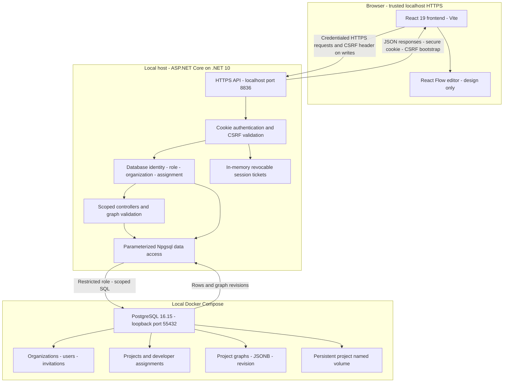

# Local application architecture

Editable diagram source for the current October 2026 portfolio application. The API and frontend are local host processes; only PostgreSQL runs in Docker. This describes verified implementation, not production infrastructure or the complete original academic design.

The frontend is served at `https://localhost:3000`. The API binds loopback HTTPS at 8836; use the hostname `localhost` for certificate validation. Credentialed CORS permits the fixed frontend origin. Authenticated requests revalidate the database account; frontend role/route state is not authorization. CSRF bootstrap/login/invited registration are explicit public exceptions with their respective controls. Password hashing uses BCrypt; cookie tickets are kept server-side in the local process and are not durable across restart.

`companycodes` is the legacy-named organization table, not an invitation-secret store. Users and projects are organization-scoped; project assignments restrict developer access. `invitations` holds email-bound, expiring, single-use registration records. `project_graphs` stores validated declarative JSONB and a revision. The legacy `test` business table is not an execution engine. Explicit expected-revision comparison protects graph writes; a 409 conflict retains the browser draft for an explicit reload decision.

All six graph categories are inert design metadata. No edge above represents graph-driven HTTP, SQL, JavaScript, API generation, scheduling or background workflow execution. An existing logging heartbeat is outside this request/data diagram and does not execute graphs. There is no browser-to-database connection.

## Source map

| Concern | Implementation |
| --- | --- |
| Frontend auth/session/routes | [AuthContext](../TDS-Frontend-main/src/contexts/AuthContext.jsx), [routes](../TDS-Frontend-main/src/routes/AppRoutes.jsx) |
| Visual editing and persistence | [editor page](../TDS-Frontend-main/src/pages/ProjectPlaygroundPageV2.jsx), [graph hook](../TDS-Frontend-main/src/hooks/useProjectGraph.js) |
| API middleware/auth/CSRF/CORS | [Program.cs](../Backend/Program.cs), [authentication contract](../database/AUTHENTICATION.md) |
| Account and project operations | [AuthController](../Backend/Controllers/AuthController.cs), [ProjectsController](../Backend/Controllers/ProjectsController.cs) |
| Graph authorization/validation/storage | [ProjectGraphsController](../Backend/Controllers/ProjectGraphsController.cs), [graph contract](../database/GRAPH_PERSISTENCE.md) |
| Development resources and schema | [Compose](../compose.yaml), [numbered SQL](../database/init), [database guide](../database/README.md) |
| Separate disposable test environment | [test Compose](../compose.tests.yaml), [guarded runner](../scripts/Test-IsolatedDatabase.ps1), [testing](../TESTING.md) |

The test runner uses a different run-owned project/volume on port 55433 with an extra test marker. It is not an additional production tier or a second persistent development database.

## Rendering and maintenance

GitHub supports fenced `mermaid` blocks in Markdown; see [GitHub's diagram documentation](https://docs.github.com/en/get-started/writing-on-github/working-with-advanced-formatting/creating-diagrams). This diagram uses basic `graph TD`, rectangular nodes, labeled edges and subgraphs rather than version-specific extensions. Keep this file as the single editable diagram source linked from the root README.

M7B validation checked the fence, node/edge references, subgraph balance and implementation mapping. No Mermaid renderer is installed in the reviewed environment; actual rendered layout and GitHub rendering remain preview checks for the future authorized release. No diagram/source was uploaded to a rendering service.
