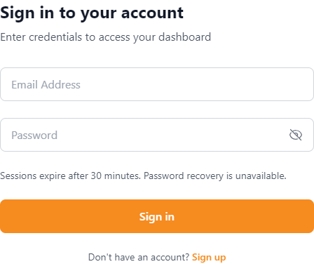
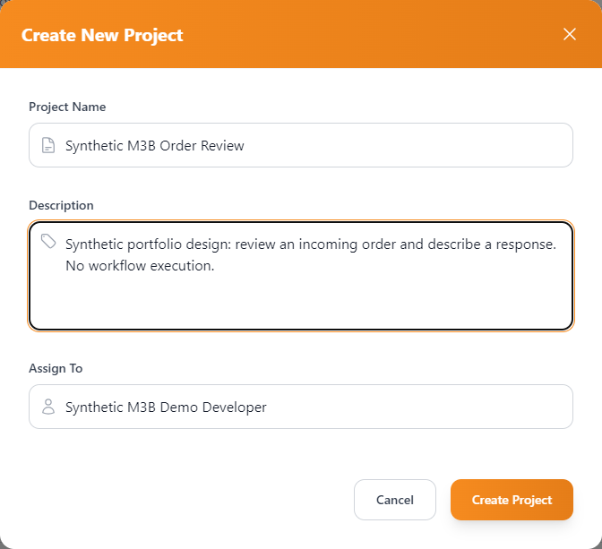

# Reviewed application captures

Actual Microsoft Edge **156.0.4314.50** screenshots, captured October 30, 2026 against the existing Vite/ASP.NET Core application with normal trusted localhost HTTPS and a disposable synthetic PostgreSQL database. These are cropped browser screenshots, not fabricated mockups. No application source, DOM text/styles, logo or image pixels were replaced for capture.

| Image | Native size | Verified state |
| --- | --- | --- |
| [login.png](login.png) | 448 × 376 | Empty login fields, normal 30-minute session notice; form crop excludes the surrounding sponsor name/banner. |
| [administrator-projects.png](administrator-projects.png) | 1280 × 900 | Synthetic organization/admin/project/assigned developer; invitation code dismissed and invitation input cleared. Main-content crop excludes the branded header and lower page content. |
| [project-creation.png](project-creation.png) | 672 × 613 | Actual filled dialog before creation, using a synthetic project/description and an invited developer; dialog-only crop. |
| [saved-graph-reloaded.png](saved-graph-reloaded.png) | 1440 × 960 | Administrator view after successful save and full reload: revision 1, six node categories and two persisted edges. |
| [developer-read-only.png](developer-read-only.png) | 1440 × 960 | Assigned developer loads the same revision; read-only status, no Save control and disabled deletion/creation. |

The editor pair uses identical dimensions. Form/dashboard crops use native proportions to exclude unconfirmed branding without changing the UI. Editor crops omit the bottom attribution/control strip from the image; the application's attribution configuration was not changed. These partial views do not imply that all branding elsewhere in the application is cleared. Utility icons are application UI, not a new sponsor endorsement.

The `Synthetic M3B` prefix is required by the established fixture's exact-owned cleanup guards. It identifies **synthetic records**, not the date/version of these images. The random `example.test` address visible in the project card is a disposable identity, not a credential, personal email or invitation code. No password, cookie, CSRF token, one-time code, private key, connection string or database row identifier appears in these captures.

## Login and project creation

The root [README](../../README.md#application-screenshots) embeds the administrator and graph views to avoid duplicating all images here.

## Provenance and integrity

Successful isolated capture run: `81d81242f1ab423d96939400df4bc34f`. Its private report identifies `portfolio-screenshot-capture`, **19/19 checks**, zero uncaught page errors and zero external requests. Fixture cleanup deleted seven direct synthetic rows (with graph cascade); original-state restoration is true. The guarded wrapper then confirmed empty test business tables, unchanged development schema/data fingerprint and existing resource inventory, and removed only its new disposable container, volume and network. This was a targeted capture, not a rerun of the full 104-assertion browser suite.

| File | SHA-256 of reviewed PNG |
| --- | --- |
| login.png | `7021fe0f133f9773a3879a40def9fcc1664169a11a1004da2de9d78f3d788b2a` |
| project-creation.png | `a652b4128ab3fe0a7de5fb0dbbd411f51977f31e3dd0ae47a2ef279d91747814` |
| administrator-projects.png | `6481b216940e22924593159356d60d83c6221f7e8e0a4990a910e18cf0f7fd5d` |
| saved-graph-reloaded.png | `f561b7a72ec531717683377c8769f83b991321a6dc31f28c3dc0824e1bc34558` |
| developer-read-only.png | `58108166a0660eb9604cf29c9ba8c32c1f8bdc62d2f0b223d17478418cbb342e` |

An earlier capture timed out during graph editing/save with required node metadata left unconfigured. The corrected capture filled that metadata through the UI and succeeded. Its earlier fixture cleanup succeeded, and the documented journaled cleanup removed only its verified disposable resources before the corrected run. Earlier evidence is retained privately; none of its images are used here. No application fix or disabled validation was needed.

These five reviewed PNGs are conditional release candidates. All raw capture reports, fixture streams and `.local` evidence remain private. Final release still requires exact-tree secret/metadata/third-party review under [the publication checklist](../../README.md); this capture does not clear other assets or grant a first-party license.
